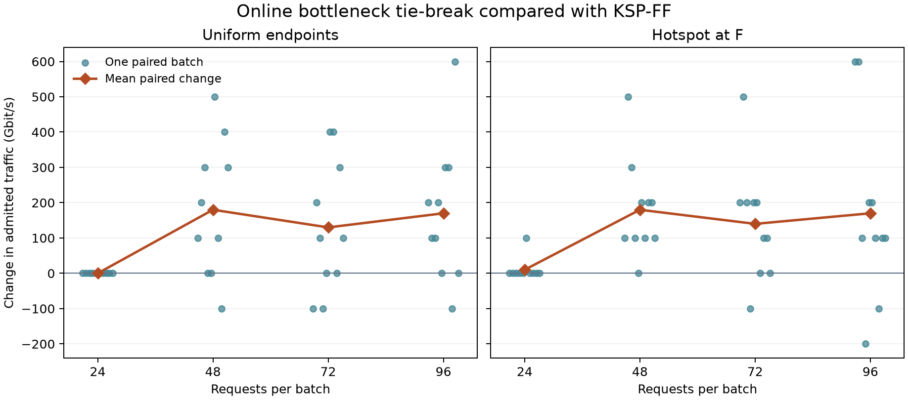

# Step 33 等长候选路径的在线拥塞感知选路

在 96 个请求时，新规则在均匀和热点场景下都比 KSP-FF 平均多接纳 170 Gbit/s。热点组有 8 批改善、2 批退步。F 的四条邻接链路在两种算法下均已用满，差异来自这些资源分配给了哪些连接。

## 实验设计

直接读取 [Step 32 的已认证结果](../results_step32/certified/traffic_results.json)，使用相同的 12 节点拓扑、每链路 8 个可分配波长、发射功率、2 dB 裕量及请求顺序。只取每个请求均为 100 Gbit/s 的两组流量。热点组以 F 为端点的概率为 65%。四档负载各有 10 个种子，共 80 个配对批次。不同负载复用种子，其请求序列有共同前缀。

按请求顺序检查同样的四条候选路径。物理层可行、净速率够用且存在公共空闲波长的路径才参与比较。优先选最短可行距离，若多条等长，则分别计算每条路径中最紧张链路的空闲波长数，选这个数最大的路径。分数相同则沿用原候选顺序。选定路径后仍取最小公共空闲波长。决策只读取当前占用，节点 F 的身份只用于流量生成和事后统计。

## 逐批对照

业务量均为每档 10 个种子的均值，单位为 Gbit/s。差值等于新规则减 KSP-FF。“胜 / 平 / 负”按同一批次接纳的业务量判断。

| 流量 | 请求数 | KSP-FF | 新规则 | 平均差 | 胜 / 平 / 负 | 离线 ILP |
|---|---:|---:|---:|---:|---|---:|
| 均匀 | 24 | 2400 | 2400 | 0 | 0 / 10 / 0 | 2400 |
| 均匀 | 48 | 4270 | 4450 | +180 | 7 / 2 / 1 | 4640 |
| 均匀 | 72 | 5220 | 5350 | +130 | 6 / 2 / 2 | 5810 |
| 均匀 | 96 | 5860 | 6030 | +170 | 7 / 2 / 1 | 6890 |
| 热点 | 24 | 2390 | 2400 | +10 | 1 / 9 / 0 | 2400 |
| 热点 | 48 | 3900 | 4080 | +180 | 9 / 1 / 0 | 4370 |
| 热点 | 72 | 4390 | 4530 | +140 | 7 / 2 / 1 | 5190 |
| 热点 | 96 | 4880 | 5050 | +170 | 8 / 0 / 2 | 5940 |

每个圆点表示一个种子的配对差值，菱形是均值。热点 96 请求的单批差值范围为 −200 到 +600 Gbit/s，平均阻塞率由 49.17% 降至 47.40%。距相同候选集的离线最优均值还差 890 Gbit/s，原差距为 1060 Gbit/s，收回约 16%。在这一组固定速率批次中，每 100 Gbit/s 差值对应一个连接。

## F 周围的资源怎样重新分配

在热点 96 请求的 10 个种子中，两种算法均用满 F 周围的 32 份链路波长资源。一个以 F 为端点的连接用一份，一个经过 F 中转的连接用两份。

| 每批平均 | KSP-FF | 新规则 | 差值 |
|---|---:|---:|---:|
| 接纳的 F 端点连接 | 25.8 | 27.2 | +1.4 |
| 接纳的 F 中转连接 | 3.1 | 2.4 | −0.7 |
| F 邻接资源占用 | 32.0 | 32.0 | 0 |
| 全网接纳连接 | 48.8 | 50.5 | +1.7 |

热点种子 0 的第 3 个请求 A→F 是两种方案首次分歧之处。两条路径同为 800 km。A–B–F 的两段各剩 8、7 个波长，A–E–F 各剩 8、8 个。原规则选前者并用波长 38，新规则选后者并用波长 37。第 6 个请求 G→I 在两种在线方案中都经过 F。第 9 个 E→K 则由 E–F–G–K 改为 E–I–J–K，两条路同为 1120 km，后一条避开 F。这个种子共从 53 个连接增至 59 个。

在种子 3 中，新规则接纳的 F 中转连接从 2 增至 3，F 端点连接从 28 降到 26，全网也从 46 降到 44。当前更空闲的路径仍可能被后续请求需要。上述增益反映这一拓扑和这十个种子的表现。

## 复现与核对

从项目根目录运行 `python step33_online_routing.py`。[完整结果](paired_results.json)包含输入哈希、每批的新分配方案、首次分歧、链路利用率及配对差值。[汇总](summary.json)包含均值、差值的样本标准差、范围及胜平负计数。基线回放逐项对照 Step 32 保存的 KSP-FF 方案，沿用已认证的 ILP 结果作为离线上界。所有 4800 次在线决策均已独立重放核对。
