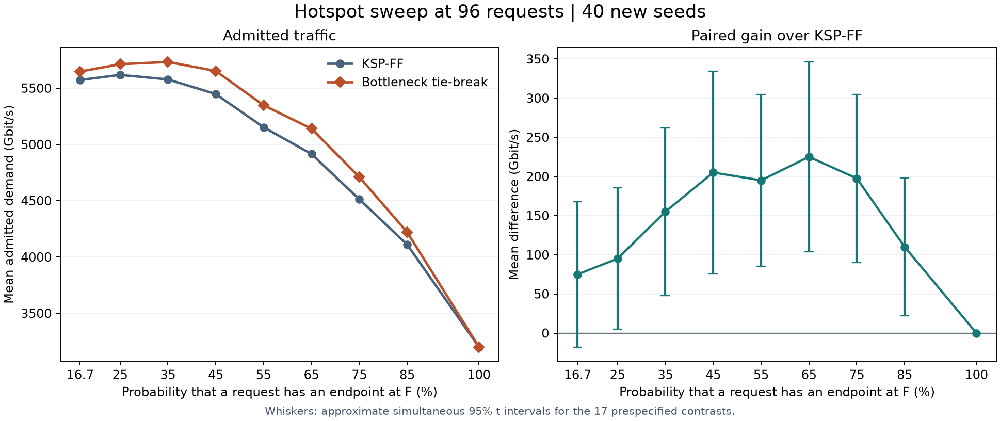

# Step 34 热点强度与在线选路收益

在 96 请求的 40 个新种子中，F 端点概率为 65% 时，Step 33 的拥塞感知规则相对 KSP-FF 平均多承载 225 Gbit/s。均匀流量下为 +75 Gbit/s。F 端点概率达到 100% 时，两种算法在所有 40 批都达到 3200 Gbit/s 的局部容量上限，平均差值为零。

## 实验设计

沿用 Step 32 的 12 节点、17 链路拓扑、每链路 8 个可分配波长、固定发射功率、2 dB 裕量、4 条候选路径与 100 Gbit/s 单请求。KSP-FF 与 Step 33 规则仅在等长可行路径的选择上有差异，两者均使用最小公共空闲波长。

扫描的是一个请求以 F 为端点的**抽样概率**。均匀流量对应 11/66，即 16.67%。其余档位中，包含 F 的 11 个节点对平分设定的概率，其余 55 对平分剩余概率。各档沿用相同的种子和抽样方式，具体节点对可以随概率改变。每一档的两种算法处理完全相同的请求和顺序。

原种子 0–9 用于复现，另取种子 10–49 单独报告新批次的结果。九档概率、五十个种子共生成 450 条长度为 96 的请求序列。在线分配的 24、48、72、96 请求结果取各序列的对应前缀，共 1800 个配对。每个种子是统计单位，同一条序列的四个负载观测有关联。均匀与 65% 两档在原有种子上的 80 个配对均通过输入哈希与两种算法的完整分配方案核对。

## 主要结果

下表是主分析负载 96 请求时，40 个新种子的均值，每批总需求均为 9600 Gbit/s。收益指同一批中“新规则接纳业务量减 KSP-FF 接纳业务量”。最后一列比较同一新种子下本档收益与均匀档收益，再跨种子取均值。所有业务量单位为 Gbit/s。

| F 端点概率 | KSP-FF | 新规则 | 配对收益 | 胜 / 平 / 负 | 比均匀档多出的收益及同时区间 |
|---|---:|---:|---:|---|---|
| 16.67% | 5572.5 | 5647.5 | +75 | 23 / 6 / 11 | 基准 |
| 25% | 5617.5 | 5712.5 | +95 | 22 / 9 / 9 | +20 [−99.8, 139.8] |
| 35% | 5577.5 | 5732.5 | +155 | 29 / 7 / 4 | +80 [−68.6, 228.6] |
| 45% | 5447.5 | 5652.5 | +205 | 29 / 2 / 9 | +130 [−42.4, 302.4] |
| 55% | 5152.5 | 5347.5 | +195 | 30 / 4 / 6 | +120 [−23.3, 263.3] |
| 65% | 4915 | 5140 | +225 | 31 / 4 / 5 | +150 [5.8, 294.2] |
| 75% | 4512.5 | 4710 | +197.5 | 29 / 5 / 6 | +122.5 [−19.2, 264.2] |
| 85% | 4110 | 4220 | +110 | 24 / 11 / 5 | +35 [−89.7, 159.7] |
| 100% | 3200 | 3200 | 0 | 0 / 40 / 0 | −75 [−167.8, 17.8] |

均匀档的 +75 Gbit/s 区间为 [−17.8, 167.8]。25% 到 85% 的七个已测档位中，各档新规则相对 KSP-FF 的收益区间均高于零。相对均匀档的额外收益，以 65% 这一档的证据最清楚。65% 是本次网格中高负载收益均值最高的观测点，精确的起效阈值和峰值位置仍待确定。

区间以 40 个新种子的配对差值为样本，用双侧 t 区间，并以 Bonferroni 校正同时覆盖预设的 17 个比较（9 个配对收益及 8 个相对均匀档的比较），近似家族覆盖率为 95%。图右显示配对收益区间，表的末列显示相对均匀档的区间。原有 10 个种子不进入这些区间。结果描述这套拓扑、抽样模型和静态负载下的跨种子变化。

## F 的资源占用

65% 档中，原有 10 个种子的收益复现为 +170 Gbit/s，新 40 个种子的收益为 +225 Gbit/s。新种子里，KSP-FF 和新规则均在每批耗尽 F 周围的 32 份链路波长资源。平均 F 中转连接由 3.100 降至 1.925，F 端点连接由 25.80 增至 28.15。少用 1.175 个中转，正好腾出 2.35 份资源供端点连接使用。全网平均多接纳 2.25 个连接，阻塞率从 48.80% 降至 46.46%。

100% 档中，所有请求都必须使用一条 F 邻接链路。四条邻接链路各有 8 个波长，所以任一方案最多同时服务 32 个这样的连接。96 请求的每个新批次中，两种算法均达到这个上界。此解释适用于此处的高负载结果。在 24 请求下，32 个端点名额已多于总请求数，实际分配仍会受到路径和波长连续性的影响。

其他负载用于描述性对照。下表列出三个代表档位下的新种子平均收益（Gbit/s）。完整九档和各档胜平负计数见汇总文件。

| 请求数 | 均匀 | 65% 热点 | 100% 热点 |
|---|---:|---:|---:|
| 24 | +2.5 | +5 | +27.5 |
| 48 | +167.5 | +220 | −2.5 |
| 72 | +130 | +242.5 | 0 |
| 96 | +75 | +225 | 0 |

## 复现

在项目根目录运行 `python step34_hotspot_strength.py`。脚本读取 Step 32 的已认证数据和 Step 33 的配对方案，通过已有分配器运行两种在线规则。每批均检查路径端点、物理可行性、波长冲突、链路利用率，以及“F 端点连接数 + 2 × F 中转连接数 = F 邻接资源占用”的计数关系。

[汇总 JSON](summary.json)保存实验配置、来源哈希及按种子组、概率和负载汇总的统计量。[逐批结果](sweep_details.json.gz)是 gzip 压缩的 JSON，包含 450 条请求序列及其两种分配方案、1800 个逐批配对记录。每条完整方案中的请求索引从 0 开始，取小于所需负载的索引即可恢复相应前缀的方案。
