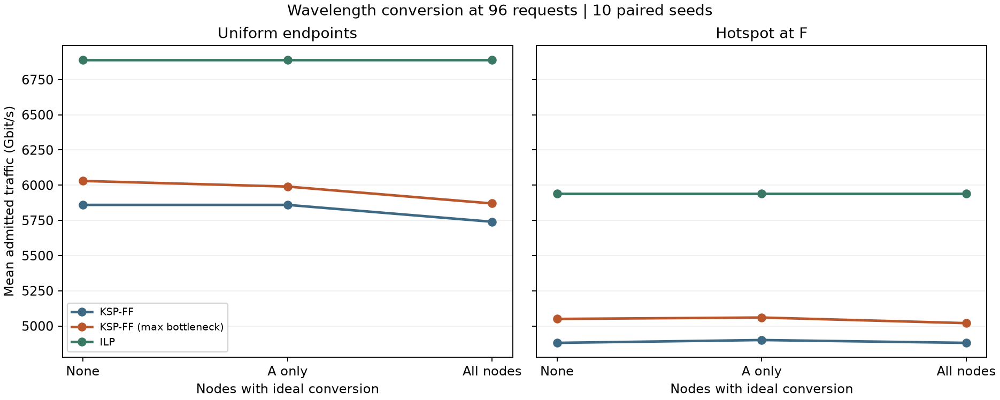

# Step 35 波长转换的在线收益和离线上限

在同样的 80 个静态批次中，只允许 A 换波长可以接通之前被拒的 D→I 请求，但 80 批的离线最优业务量均与无转换相同。所有节点可转换时，3 批的离线最优各增加 100 Gbit/s，其余 77 批持平。在线算法对转换的反应取决于负载和请求顺序。

## 实验条件

使用 Step 32 保存的均匀与 65% 热点流量，每批 24、48、72 或 96 个 100 Gbit/s 请求，种子为 0–9。三个配置分别是全网无转换、只有 A 可转换、所有中间节点可转换。A 是根据之前讨论的 D→I 案例预先确定的节点。各配置复用相同的节点对顺序、四条候选路径、17 条链路、每链路 8 个波长、原公共功率及 2 dB 裕量。

每个请求在经过的每条链路上独占一个波长，直到批次结束。在启用转换的中间节点，可以保持波长或改用任一可用波长。建模假设为转换器数量充足，无额外噪声、费用或信号再生。调制、净速率与 SNR 仍按完整端到端路径检查。这一实验测量放宽连续性带来的作用。

两种在线规则均按原顺序接纳请求。KSP-FF 选择第一条可行路径，Step 33 的规则优先选最短可行路径，并在等长时选瓶颈链路剩余波长最多的路径。路径选定后，先最小化实际换波长次数，再选择波长编号序列字典序最小的分配。无转换配置在全部 80 批中逐请求复现了两种规则的原始分配。

## D→I 第 35 个请求

在 `uniform_fixed-48-0` 中，原 KSP-FF 处理完前 34 个请求后，D–C–B–A 的公共空闲波长是 44，A–E–I 的公共空闲波长是 41 和 43。令 A 将 44 转为 41，即可接通 100 Gbit/s 的 D→I。选 43 也可行，实际规则优先选 41。

从批次起点重新运行时，仅 A 可转换的 KSP-FF 接纳了第 35 个 D→I，随后拒绝了原本接纳的第 36 个 B→L。全网可转换的 KSP-FF 同样接纳了第 35 个，少接纳的是第 40 个 C→F。三种配置的批次总量都是 4400 Gbit/s。

## 各负载实测结果

每格按“无转换 / 仅 A / 全网”的顺序报告平均接纳业务量，单位为 Gbit/s，各组为 10 个配对种子。

| 流量 | 请求数 | KSP-FF | Step 33 在线规则 | 离线最优 |
|---|---:|---|---|---|
| 均匀 | 24 | 2400 / 2400 / 2400 | 2400 / 2400 / 2400 | 2400 / 2400 / 2400 |
| 均匀 | 48 | 4270 / 4280 / 4430 | 4450 / 4450 / 4550 | 4640 / 4640 / 4640 |
| 均匀 | 72 | 5220 / 5230 / 5210 | 5350 / 5350 / 5440 | 5810 / 5810 / 5810 |
| 均匀 | 96 | 5860 / 5860 / 5740 | 6030 / 5990 / 5870 | 6890 / 6890 / 6890 |
| 热点 | 24 | 2390 / 2390 / 2400 | 2400 / 2400 / 2400 | 2400 / 2400 / 2400 |
| 热点 | 48 | 3900 / 3940 / 4040 | 4080 / 4080 / 4180 | 4370 / 4370 / 4370 |
| 热点 | 72 | 4390 / 4430 / 4490 | 4530 / 4540 / 4630 | 5190 / 5190 / 5220 |
| 热点 | 96 | 4880 / 4900 / 4880 | 5050 / 5060 / 5020 | 5940 / 5940 / 5940 |

在均匀 96 请求批次中，全网转换的 KSP-FF 在前 48 个请求平均多承载 160 Gbit/s，后 48 个平均少承载 280 Gbit/s，合计少承载 120 Gbit/s。其 10 个种子为 2 胜、1 平、7 负。以每种规则当时的资源状态分别计数，无转换时平均 15.3 次拒绝发生在“至少一条候选路径各段尚有余量，但波长对不上”的情况下，另有 22.1 次拒绝时每条候选路径都含满载链路。全网可转换后，连续性阻塞为零，拒绝的 38.6 个请求都遇到满载链路。前面的分配会改变后面可用的资源。

三个离线增益都发生在热点 72 请求组。种子 0、5、7 的最优值分别从 5300、5100、5000 增至 5400、5200、5100 Gbit/s。全网转换保留所有无转换的可行分配，因此最优值只能持平或上升。在线规则逐个作决定，增加当前可选方案也可能改变后续接纳结果。

## 离线建模和核对

按相同节点对及需求汇总可互换的请求，用整数变量表示每条候选路径接纳多少连接，限制同类请求总数及每条边的波长容量。路径在允许转换的节点处划分为透明段。多链路透明段用二进制变量选择波长，每个选定波长必须能贯穿该段，同一链路上的同一波长最多使用一次。单链路段在其他段占用波长后，从余量中取得具体波长。每个解都还原为逐请求、逐链路的实际分配。

无转换的最优值来自 Step 32 的已认证结果。对于单 A 配置，一个经检查的可行方案给出下界，全网转换最优值给出上界。77 个批次上下界直接相等，另外 3 批通过单 A 的整数模型完成证明。ILP 的目标为接纳业务量，保存的离线波长变化次数取决于等价最优解及其波长分配。

独立核对了 720 个分配方案的候选路由、端到端物理条件、波长冲突、允许的转换位置和业务量。另一套逐请求二进制模型独立复算了全部 80 个全网转换最优值。小网络测试还用逐链路波长组合穷举验证了分段整数模型。

从项目根目录运行 `python step35_wavelength_conversion.py` 可复现实验。参见[结果汇总](summary.json)、[逐次分配与最优性证明记录](plans.json.gz)和[分配实现](../wavelength_conversion.py)。完整方案中请求编号从 0 开始，`waves[i]` 是路径第 i 条链路实际占用的波长。
