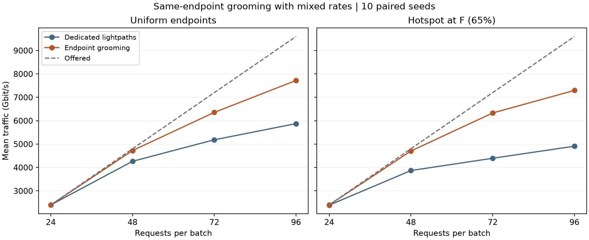

# Step 36 同端点业务疏导

在 96 请求的热点混合速率批次中，同端点疏导将 KSP-FF 的平均接纳业务量从 4910 提高到 7295 Gbit/s，接纳请求数从 48.8 提高到 74.7。平均建立的光路数由 48.8 降至 44.8，全网占用的链路波长资源由 101.7 降至 94.5。均匀流量在同一负载下平均多承载 1845 Gbit/s，热点流量多承载 2385 Gbit/s。

## 配对方法

沿用 Step 32 的均匀与 65% 热点流量、四档负载及种子 0–9，共 80 个静态批次。请求速率严格按 1:2:1 分配为 50、100、150 Gbit/s。保存的每批请求顺序和输入哈希均经过核对。原规则逐请求重放，与已保存的 KSP-FF 方案逐项相符。

对照组每个请求建立专用光路。实验组先检查端点和方向都相同的已建光路。如果有足够余量容纳整个请求，选装入后剩余容量最小的一条，并列时选最早建立的一条。否则，和对照组一样，检查相同的四条候选路径，取第一条可行路径上的最小公共空闲波长。新建光路按其端到端 SNR、2 dB 裕量、调制及 FEC 确定净容量。一个物理光路在每段链路独占一个连续波长，客户业务在该光路的净容量内汇聚。

模型只允许端到端共享，不拆分客户请求，也不在中间节点加入业务。端点设备假设支持这三档客户速率，按净带宽记账，未加客户端口数、支路时隙或额外封装开销约束。原输入按无序节点对生成，每对以固定方向记录；这里的匹配严格使用记录的源、目的方向。连接在整批期间持续占用资源。比较对象为两种在线服务规则。

## 业务量和请求数

各项均为每档 10 个种子的均值，业务量单位为 Gbit/s。“胜 / 平 / 负”比较同一批次的接纳业务量。

| 流量 | 请求数 | 专用光路 | 允许疏导 | 增量 | 接纳请求数（专用 → 疏导） | 胜 / 平 / 负 |
|---|---:|---:|---:|---:|---:|---|
| 均匀 | 24 | 2400 | 2400 | 0 | 24.0 → 24.0 | 0 / 10 / 0 |
| 均匀 | 48 | 4265 | 4725 | +460 | 42.7 → 47.3 | 10 / 0 / 0 |
| 均匀 | 72 | 5185 | 6355 | +1170 | 52.2 → 63.9 | 10 / 0 / 0 |
| 均匀 | 96 | 5875 | 7720 | +1845 | 58.6 → 78.6 | 10 / 0 / 0 |
| 热点 | 24 | 2390 | 2400 | +10 | 23.9 → 24.0 | 1 / 9 / 0 |
| 热点 | 48 | 3870 | 4705 | +835 | 39.0 → 47.1 | 10 / 0 / 0 |
| 热点 | 72 | 4395 | 6330 | +1935 | 43.9 → 63.9 | 10 / 0 / 0 |
| 热点 | 96 | 4910 | 7295 | +2385 | 48.8 → 74.7 | 10 / 0 / 0 |

热点 96 请求组的逐批业务量增益为 1500–2900 Gbit/s。平均请求阻塞率从 49.17% 降到 22.19%，业务阻塞率从 48.85% 降到 24.01%。每批平均有 29.9 个请求直接复用光路。和原接纳名单相比，平均新增 26.4 个请求，同时有 0.5 个原先接纳的请求被挤出，净增 25.9 个。复用次数和净增请求数衡量的是两件不同的事。

## 哪些速率受益

下表汇总每种分布在 96 请求、10 个种子下的分档接纳数。分母为该档提交数。

| 客户速率 | 均匀专用 | 均匀疏导 | 热点专用 | 热点疏导 |
|---|---:|---:|---:|---:|
| 50 Gbit/s | 147/240 (61.25%) | 214/240 (89.17%) | 118/240 (49.17%) | 205/240 (85.42%) |
| 100 Gbit/s | 289/480 (60.21%) | 386/480 (80.42%) | 246/480 (51.25%) | 372/480 (77.50%) |
| 150 Gbit/s | 150/240 (62.50%) | 186/240 (77.50%) | 124/240 (51.67%) | 170/240 (70.83%) |

三档接纳比例都上升。热点组 50 Gbit/s 档的增幅最大，达到 36.25 个百分点。这与较小请求能装入更多剩余容量区间相符，也包含资源占用变化引起的后续选路效果。

## 光路资源和 F 端点

资源按唯一的“物理链路、波长”组合计算。一条跨三段链路的光路占三份资源；在其中再接纳客户业务只消耗该光路的剩余净带宽。

| 96 请求时的每批均值 | 均匀专用 | 均匀疏导 | 热点专用 | 热点疏导 |
|---|---:|---:|---:|---:|
| 建立光路数 | 58.6 | 50.5 | 48.8 | 44.8 |
| 全网已用链路波长资源 | 118.3 | 110.3 | 101.7 | 94.5 |
| 以 F 为端点的客户请求数 | 8.6 | 11.2 | 25.8 | 47.9 |
| 以 F 为端点的物理光路数 | 8.6 | 7.8 | 25.8 | 23.3 |
| 经过 F 中转的物理光路数 | 10.5 | 10.6 | 3.1 | 3.8 |
| F 周围已用链路波长资源 | 29.6 | 29.0 | 32.0 | 30.9 |

热点组里，23.3 条 F 端点光路平均承载了 47.9 个 F 端点客户。再加上 3.8 条中转光路，占用的 F 邻接资源为 23.3 + 2 × 3.8 = 30.9，上限仍为 32。

## 热点种子 0 的 C→F 请求

在原 KSP-FF 分配中，第 19 个请求（50 Gbit/s）建立 C–B–F、波长 41 的光路，其净容量约为 213.33 Gbit/s。第 36 个请求（150 Gbit/s）被拒。如果固定原先的分配，两份业务合计 200 Gbit/s，物理容量确实足够。

从第一个请求开始允许疏导后，第 2 个 C→F 请求（100 Gbit/s）先建立了 C–B–F、波长 37 的光路。第 19 个请求复用它后已用 150 Gbit/s，还剩 63.33 Gbit/s。第 36 个客户的 150 Gbit/s 需要另建光路，最终使用 C–B–F 的波长 43 并得到接纳。整批从 53 个、5300 Gbit/s 变为 81 个、7800 Gbit/s。

## 复现与核对

执行 `python step36_endpoint_grooming.py`。[汇总数据](summary.json)包含逐场景两组均值、分档接纳率和配对差值范围。[完整配对方案](paired_plans.json.gz)保存原始请求、每条光路的波长和净容量、客户编号及最终带宽占用。请求编号字段从 0 开始。所有 160 次分配合计 9600 次顺序决策已独立重放检查，包括最紧适配、波长连续性、净容量和每段波长只计一次。
